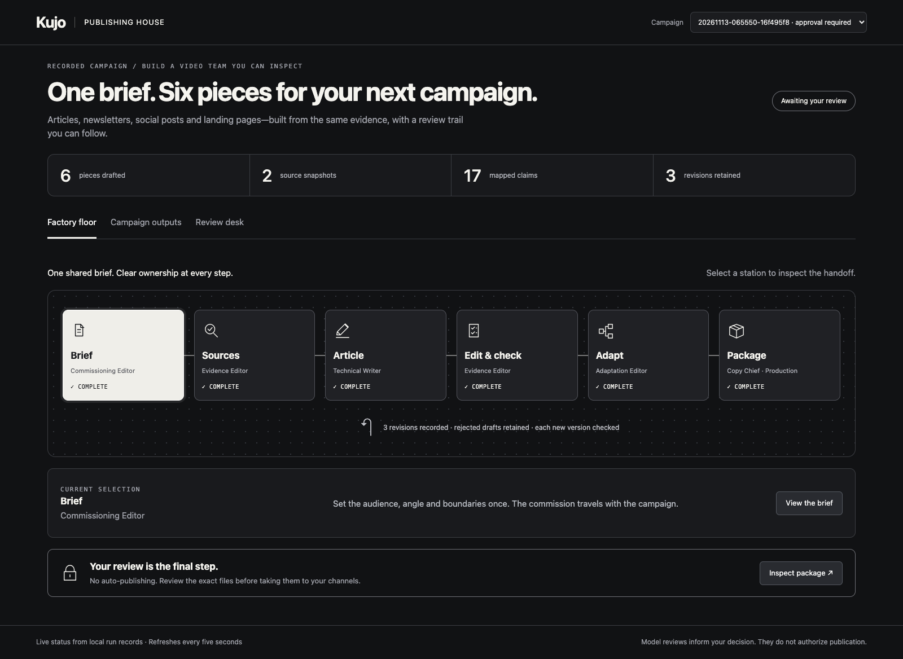

# Kujo Publishing House Factory

[](package.json)
[](LICENSE)
[](https://github.com/kujolang/kujo)
[](https://github.com/kujolang/publishing-house-factory/actions/workflows/verify.yml)

Give your editorial team a sourced brief. Get an article, newsletter, social posts and a landing page you can inspect before publishing.

https://github.com/user-attachments/assets/70d1afe4-b7b4-4951-a14d-ad50c697357f

[Download the video for your phone — 720p](https://github.com/kujolang/publishing-house-factory/raw/refs/heads/main/docs/media/publishing-house-factory-demo-mobile.mp4) · [1080p original](https://github.com/kujolang/publishing-house-factory/raw/refs/heads/main/docs/media/publishing-house-factory-demo.mp4) · [Video source and review notes](docs/DEMO.md)

Publishing House Factory runs the existing Kujo Publishing House Operator with a live editorial adapter. It preserves sources, maps claims to exact excerpts, separates writing from review, and binds the resulting campaign to exact file hashes. The local Factory Floor shows real phase receipts and links to the work.

**Standalone local release.** This repository packages one editorial workflow. [Software Factory](https://github.com/kujolang/software-factory) and [VideoOps Factory](https://github.com/kujolang/videoops-factory) remain separate. These factories share Kujo tools and design patterns; they are not three copies of one domain controller.



[Inspect the live example campaign](docs/example-campaign/README.md) · [Verification evidence](docs/VERIFICATION.md)

## Start here

Use macOS or Linux (including a compatible WSL environment), Git, Python **3.10+**, Node **26.12.1 or later 26.x**, and a Codex account. Setup downloads pinned source revisions and the npm-packaged Kujo runtime. You do not need sibling repositories, a Rust build, Docker, FFmpeg or a database. Minimal Linux installations may need `libatomic1` for Node.

```sh
git clone https://github.com/kujolang/publishing-house-factory.git
cd publishing-house-factory
npm ci
npm run setup
npm run login
npm run doctor
npm run verify
npm start
```

Open `http://127.0.0.1:4382`. In another terminal:

```sh
npm run factory -- run examples/videoops-launch.json
```

Already signed in to Codex? Use `npm run login -- --reuse-existing` instead. It copies only authentication into the ignored factory home; it does not import tools, hooks or user configuration. Model calls use your account. Set `PUBLISHING_MODEL` to choose an available model.

The included brief uses preserved VideoOps README and onboarding evidence. Its output explains the software, setup observations and review limits. It does not promise a universal installation time.

## What the factory does

| Stage | Work and evidence |
| --- | --- |
| Commission | StoryDesk records the commission; a Commissioning Editor proposes the angle and outline. |
| Evidence | A Standards & Evidence Editor maps claims to captured excerpts. Dossier records sources, claims and observed support. |
| Article | A Technical Editor/Writer drafts the article with claim references. GalleyPack records its bytes. |
| Assets | Records the text-only production choice. No image or media provider runs. |
| Review | A separate Standards & Evidence Editor call checks the draft. BluePencil records the review; at most two writer revisions follow. |
| Adapt | A Franchise & Adaptation Editor produces a newsletter, three social posts and landing-page copy from the reviewed article. |
| Package | A Copy Chief checks the adaptations, with up to two revisions. Trusted code renders escaped HTML. GalleyPack freezes the manifest; VersionSeal records an approval request. |
| Approval | The canonical operator stops at `approval_required`. A human must review the exact package. |

Model calls run sequentially as tool-free proposals. They cannot run source code, browse, modify the controller or publish. A source match proves that an excerpt exists; it does not prove that a claim is true. Model review is not human approval.

## Inspect, resume and verify

```sh
npm run factory -- status
npm run factory -- resume RUN_ID
npm run factory -- verify RUN_ID
```

Runs live under `.runtime/runs/RUN_ID/`. Open the article, newsletter, social posts, landing preview, reviews and package from the viewer. `verify` re-hashes every file listed in the package, including source snapshots and proposal evidence.

The canonical operator owns phase checkpoints, local leases and bounded retries. `resume` releases a blocked item after you fix the cause; it preserves completed work. Changed inputs or a review that exhausts its revision allowance require a fresh run. No command in this release approves or publishes a campaign. It also rejects publication-phase requests passed directly to the adapter.

## Give this to your agent

> Read [the agent setup guide](docs/AGENT-SETUP.md). Install this factory, turn my idea and supplied source files into a valid brief, run the campaign, and show me the package and review findings. Do not publish it.

Change the audience, voice, objective, constraints and sources without rewriting the controller. The first contract produces an article, newsletter, three social posts and a local landing page. New formats or delivery destinations require an explicit extension and tests.

- [Architecture and component reuse](docs/ARCHITECTURE.md)
- [Brief contract and agent setup](docs/AGENT-SETUP.md)
- [Review, recovery and publication boundaries](docs/REVIEW.md)
- [Verification and measured run evidence](docs/VERIFICATION.md)
- [Security model](SECURITY.md)

MIT licensed. Keep your credentials and unpublished work out of Git.
