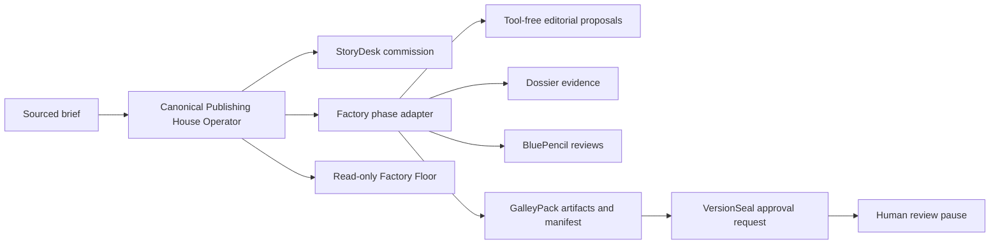

# Architecture and reuse

The standalone repository installs pinned components into `.runtime/deps/`. `sources.lock.json` identifies every upstream commit; `package-lock.json` pins the Node closure. No personal sibling checkout is needed.

The canonical operator owns the phase list, local lease, bounded attempts, checkpoint files, notification classes and approval pause. The factory uses its Python API and executable phase-adapter contract without copying the operator implementation. Each phase returns a matching item ID, phase, existing artifact, SHA-256 and `external_effect: false`.

StoryDesk owns commissioning records. Dossier preserves source and claim records; captured matches are classified as observed support. BluePencil records independent model judgments. GalleyPack binds drafts, revisions, adaptations and the frozen campaign manifest. VersionSeal records the request for exact-version human review.

The installed Dispatch and Agents SDK repositories satisfy the canonical operator's dependency layout and remain available for broader workflows. This adapter calls Codex directly for structured proposals; it does not claim to run its workers through Dispatch or Agents SDK. The canonical operator is the active control loop. PressWire is installed but no publication effects run. No fixture workflow is presented as live provider work.

The adapter implements seven bounded phases. Writing and reviewing are separate sequential calls with fresh provider sessions. The primary article allows two revisions; adaptations receive a separate Copy Chief review and up to two revisions before blocking if changes remain. A successful model review still leads to human review. The text-only asset stage records why no media generation is needed.

Each run has preserved input, request/proposal pairs, tool inputs and receipts, phase artifacts, canonical operator state, local outputs and a package manifest. Retried phases reuse proposals only when their request matches. Completed phase artifacts and retained outputs are re-hashed before continuing. New runs also seal the captured brief and source packet. The phase adapter matches each packet entry with the preserved source bytes before passing it to a worker. Canonical immutable tool records are validated on replay.

The viewer projects campaign status and serves the sources, review decisions and drafts used by the review floor. It does not invent agents, progress, approvals or completion. Local output links work while the server is running; no remote hosting is implied.

This release deliberately supports one campaign contract. Add a new format by extending the explicit schema, trusted compiler and tests. Add a live destination only through a reviewed PressWire adapter with VersionSeal authority and destination verification. Do not enable the operator's generic approval command as a shortcut around that work.
